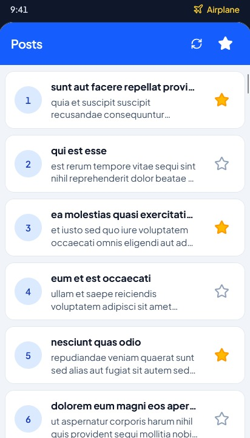

# Offline Posts App with Hive & Favorites Box

** Section 5 Assignment**

A Flutter application that fetches posts from `https://jsonplaceholder.typicode.com/posts`, caches them locally using **Hive** (`postsBox`) for offline access, and allows users to bookmark favorite posts in a dedicated persistent Hive box (`favoritesBox`).

---

## Features

- **Offline-First Posts Feed**: Fetches posts from the REST API when online and caches them in `postsBox`. Automatically falls back to cached posts in Airplane Mode.
- **Persistent Favorites Box**: Uses a separate `favoritesBox` keyed by `post.id` so favorites survive pull-to-refresh (`postsBox.clear()`), app restarts, and offline mode.
- **Instant Reactive UI**: Uses `ValueListenableBuilder` on `Hive.box<Post>('favoritesBox').listenable()` so star icons and the Favorites screen update immediately.
- **Empty State Handling**: Displays `"No favorites yet"` when `favoritesBox` is empty.
- **Graceful Error State**: Displays `"No Internet and No Cached Data"` when launched offline with an empty cache.

---

## Project Structure

```text
lib/
├── main.dart                     # Initializes Hive, registers PostAdapter, opens boxes
├── models/
│   ├── post_model.dart           # Post HiveObject model (@HiveType(typeId: 0))
│   └── post_model.g.dart         # Generated PostAdapter
├── services/
│   ├── post_service.dart         # API + postsBox offline caching logic
│   └── favorites_service.dart    # toggleFavorite, isFavorite, getFavorites
└── screens/
    ├── posts_screen.dart         # Posts list + star toggle + AppBar Favorites action
    └── favorites_screen.dart     # Saved favorites list + empty state
```

---

## Getting Started

```bash
# 1. Install dependencies
flutter pub get

# 2. Generate Hive TypeAdapter
dart run build_runner build --delete-conflicting-outputs

# 3. Run the app
flutter run
```

---

## Screenshots

> Add your screenshots inside a `screenshots/` folder in your repository before pushing.

### 1. Posts Screen (Online & Favorited Stars)



### 2. Favorites Screen (Populated)


### 3. Favorites Screen (Empty State - "No favorites yet")


### 4. Offline / Airplane Mode Test (App Restarted Without Internet)

