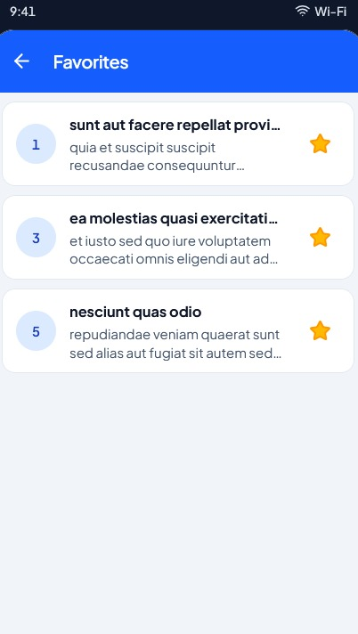

# Offline Posts App (Hive)

 using Flutter and Hive to cache posts locally and save favorite posts.

## What it does
- Fetches posts from `jsonplaceholder.typicode.com/posts` and caches them with Hive (`postsBox`).
- Allows saving and removing favorite posts in a separate box (`favoritesBox`).
- Shows cached data when offline and handles empty or error states.

## Run locally
flutter pub get
dart run build_runner build --delete-conflicting-outputs
flutter run

## Screenshots

